# 9.3 建立可验证的实验环境：order-review-lab

## 9.3.1 两种语言，各自负责什么

打开仓库时，先不要从所有配置文件读起。沿一次请求走一遍，会更快建立地图：HTTP 接收谁想做什么，应用服务组织一次操作，核心计算产生金额，数据库保存历史与状态。评审系统在这条业务路径之外读取材料，它不会代替应用服务处理客户退款。

想象用户按下“提交订单”。前端提交商品和券的标识；服务器根据可信商品、优惠与资格信息计价；成功后把这次结果固定下来。几天后用户退款，服务器先确认操作资格，再从已保存的历史中取出应退金额。前后两次请求之间的距离，正是本章缺陷出现的地方。

订单业务使用 Java 17、Spring Boot、MyBatis 和 MySQL；Python 保存共享评审流程。这是两个职责边界：业务系统负责订单行为，评审系统读取规则与证据后形成报告。后者保留在 `wallet-review-lab` 目录，是历史工程命名，不表示订单业务仍使用钱包模型。

业务工程由四个 Maven 模块组成。core 提供计价、分摊和退款计算；infra 实现持久化、事务及快照；api 提供 HTTP；test 使用真实 MySQL 验证事务与接口。固定适配器提供商品价格、品类、新人资格和优惠券。本章不实现外部支付、券库存或 Redis 协调。



**图 9-1 业务执行与评审流程的职责边界。** Oracle 在报告生成后参与评分，修复补丁在验收阶段使用，两者不进入普通评审上下文。

## 9.3.2 先理解订单单位，再理解退款

商品行表示“一种商品买了几件”，购买单位表示其中可独立退款的一件。C 买一件时，单位 ID 为 `C#001`；买两件时还有 `C#002`。分摊落到单位，退款提交单位 ID，才能明确处理部分数量。

以下是教学摘录，字段用于解释关系，不是数据库表结构或完整 API 返回：

```json
{
  "root_order": "O-100",
  "unit": "C#001",
  "activity_cents": 8000,
  "order_coupon_share": 1000,
  "new_user_share": 400,
  "paid_cents": 6600,
  "refunded": false
}
```

快照保存下单时的分摊；单位账本保存是否已退；根订单保存共享的累计退款约束。快照不应随退款改写，单位状态则必须随成功退款改变。把“不可变”误解为所有订单数据都不能更新，会无法表达后续状态。

拆成 A/B 与 C 两个子单后，C 子单仍引用根订单和 `C#001`，金额仍为 6600 分。子单不是新的退款额度来源；从子单退过该单位，父单也不能再退。9.7 的状态案例将利用这一关系检查实现。

### 四类数据为什么要分开

快照回答“下单时认定了什么”，单位账本回答“哪些东西已经退过”，退款记录回答“哪次退款发生了多少”，幂等记录回答“这个请求以前返回过什么”。它们会在同一次事务里配合，但不能互相替代。仅保存订单总实付，无法恢复某个单位的原始分摊；仅保存已退标志，也无法重放第一次请求的完整结果。

在表结构中可以看到这种分工：orders 连接根订单和快照，order_units 用根订单与单位 ID 唯一标识退款对象，order_memberships 记录父子单包含哪些单位，refund_requests 保存退款结果，idempotency_records 保存请求指纹与响应。先理解每张表回答的问题，再看字段，记忆负担会小很多。

以拆单为例，业务视图产生了两个子单，原来那件 C 仍是同一个购买单位。order_memberships 可以改变“从哪个订单入口看到它”，根单位账本继续约束“它是否已经退款”。如果对子单重新创造退款单位，就需要额外证明父子状态如何同步；本章通过共享原身份避开这层复杂性。

### 为什么历史快照还要有格式版本

保存 JSON 并不意味着多年以后一定能读懂。程序升级可能重命名字段、改变构造方式，甚至改变金额解释。快照版本用来说明怎样解码，业务规则版本说明当时按什么规则计价，二者承担不同职责。当前读取还受序列化实现约束，不能因为有一个 version 字段就认为已经实现完整的跨版本迁移。

遇到没有可信快照的历史订单，代码转入人工核对。这个选择会降低自动处理比例，却保留了“金额必须有依据”的要求。生产迁移若要自动恢复历史，还需明确数据来源、转换规则和核对办法，本章没有把这些步骤藏在一个默认值里。

## 9.3.3 十条规则怎样进入代码

**表 9-3 业务规则到验收测试的映射**

| 业务规则 | 关键实现/测试 |
| --- | --- |
| 三类券与固定顺序 | PricingService，活动价→品类→满减→新人 |
| 互斥方案比较最终实付 | exclusiveChoiceComparesLegalFinalAmounts |
| 品类资格控制门槛与分摊 | categoryEligibilityControlsThresholdAndAllocation |
| 满减采用品类优惠后金额 | orderThresholdUsesPostCategoryAmount |
| 抵扣封顶、实付非负 | capIsRecordedAndQuantityRefundUsesFrozenUnitShares |
| 整数分与分摊守恒 | largestRemainderNeverLosesCents、输入约束测试 |
| 退款使用原始分摊 | refundUsesImmutableSnapshotAfterRuleChange |
| 拆单保留分摊与共享账本 | splitKeepsOriginalSharesAndSharedRefundLedger |

首版每类最多使用一张候选券。互斥时比较合法路径的最终实付，同额优先满减路径；单价与整单上限为 10^12 分，每行最多 100 件，整单最多 1000 件。比例用整数基点，券阶段向下取整一次，再按最大余数法分至单位。详细取舍以业务契约为准。

## 9.3.4 事务为什么同时保护结果与重试

订单提交在同一事务写入订单、单位、券消费、快照和幂等响应。退款先通过用户行锁串行化同用户写入，再锁根订单，检查所有权、单位状态及额度。单位条件更新和唯一约束提供额外保护。

用户行锁牺牲同用户吞吐量，换取可解释的教学实现。锁保护访问次序，状态判断保护业务资格，条件更新确认实际改动，两者作用不同。仅有锁而没有已退检查，仍可能串行地退两次。

幂等键按用户与操作隔离，退款还绑定订单。相同键和相同请求应返回首次响应，不同请求应冲突。失败事务回滚，不写成功结果。无可信快照的历史订单进入人工核对，不使用实时规则补猜金额。

### 用时间线理解事务

一次成功退款可以依次理解为：获取操作所需的锁，读取并验证原订单，确认单位仍可退，计算历史金额，更新单位与累计退款，保存退款记录和幂等响应。事务使这些写入共同提交；中间失败则共同回滚。否则可能出现单位已标记为退过，结果记录却没有保存，客户重试也无法得到明确答复。

“共同提交”只解决原子性这一方面。判断条件写错，事务也会完整地提交错误结果；锁住两个请求，只能让它们按顺序进入临界区，后来的请求仍需要检查最新状态。9.7 的 ORD-04 正好保留锁而破坏状态检查，帮助我们把这几个作用分清。

本章没有真实外部支付。如果将退款指令发送到远端支付机构，本地数据库回滚无法撤销已经成功的远端操作。那时需要另外设计操作标识、重试、对账和补偿协议。读者应把当前事务结论限制在已经实现的数据库边界内，迁移时再画出新增边界。

## 9.3.5 从干净环境运行

需要 JDK 17、Docker、Python 3.12 及 uv，并能访问 Maven 与容器镜像仓库。从仓库根目录执行以下代码块；括号创建子 shell，结束后仍留在仓库根目录。

```bash
(
  cd order-review-lab
  ./mvnw -B -ntp clean verify
  python3 scripts/check_coverage.py
)
```

Maven Wrapper 固定 Maven 3.9.14 和发行包 SHA-256。非默认 Docker socket 可通过 DOCKER_HOST 设置，JDK 可通过 JAVA_HOME 选择；缺少 Docker 会使集成测试失败，不会换成 H2 后继续报告成功。

执行记录：冻结教学基线有 8 项核心测试和 10 项集成测试；维护主线另加历史快照格式漂移回归，共 19 项。主线核心行覆盖率 90%，聚合为 96.45%。读者应先核对版本，再比较测试数量；覆盖率不说明每条断言都足够强。

## 9.3.6 版本入口与首次阅读任务

`order-baseline-v1` 与 `order-stacking-v1` 指向同一冻结正确基线；各案例在 `case/order/ORD-*` 和 `fix/order/ORD-*` 分支中。主线继续维护依赖补丁，历史证据仍绑定当时版本。

先读 `fixtures/refund-stacking.json`、业务契约及 ORD-09 的补丁，画出 quote、snapshot 和 refund 的关系。暂不运行修改案例资产的 verify。完成标志是能说明退款金额来自哪里、哪一项数据随规则配置变化、哪一项应保持不变。路径与首次运行故障处理见 9.12。
