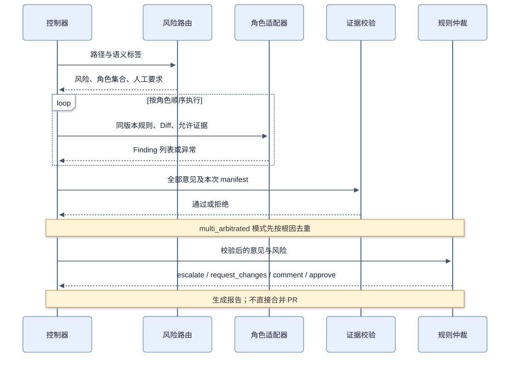

# 9.5 专业化多 Agent 协同：共享证据，隔离结论

一位助手已经能读规则、代码和日志，多位助手还能增加什么？先从人类评审看：熟悉业务的人注意退款口径，熟悉测试的人注意用例是否真的能发现错误，熟悉安全的人检查用户身份与权限。共同阅读同一改动时，他们沿着不同的问题寻找材料，有机会发现彼此没有检查的关系。

把这种分工搬到软件里，首先要设计的是问题之间的分配。角色名只是入口。如果四个角色都收到“全面检查这段代码”，再分别写一份长总结，开发者得到的可能是四倍阅读量。本节沿同一个 ORD-09 说明怎样拆任务、怎样交接，以及多角色为什么也可能一起犯错。

## 9.5.1 什么时候值得拆分角色

拆分任务的一个实际理由是审阅关注点相互竞争：计算器是否满足金额约束、测试是否触发时间变化、HTTP 是否检查所有权，都需要不同的证据路径。分工可以让每个任务更窄，也增加交接、重复和费用。

角色应由需要交付的判断定义，不能只换一个名字。“你是严格审查者”与“你是资深专家”若读取相同输入、采用相同假设，仍可能一起漏检。多次输出一致，也可能只是共享了同一种错误。

### 一个角色究竟代表什么

在本工程中，一个角色由任务专长和统一接口表达，不需要部署一套独立服务，也不意味着采用不同厂商模型。correctness 与 test 可以通过同一种适配器运行，区别在于它们被要求回答的问题。角色数量描述分工，模型数量描述使用的模型配置，这两项不能混为一谈。

拆分有两个条件。第一，问题之间能产生不同的检查路径。例如 correctness 确认历史依据，test 确认反例是否改变规则。第二，结果能重新汇合。如果 test 发现断言没有检查持久化，这项信息应该补充验收范围；不必把它包装成另一个已经发生的少退事故。

也有不值得拆的情况。一个低风险说明文件只需核对接口名称，多角色可能重复同样工作；一段缺少业务规则的退款代码，增加角色也无法凭空知道口径。先补材料、再考虑分工，通常比用更多角色补偿缺失信息更容易解释。

**表 9-5 订单评审的角色任务契约**

| 角色 | 要回答的问题 | 应交付的证据或结论 | 不应替代的职责 |
| --- | --- | --- | --- |
| correctness | 哪个业务关系被变更破坏 | 规则、调用位置、可反驳的输入 | 直接批准金额口径 |
| test | 当前用例能否区分正确与错误实现 | 反例、断言缺口、回归建议 | 以覆盖率代替测试有效性 |
| security | 主体、数据和执行边界是否保持 | 跨用户请求、注入或依赖证据 | 把静态特征命中当攻击成功 |
| impact | 历史状态怎样传播到其他操作 | 快照、拆单、账本的影响路径 | 没有证据就声称存在新缺陷 |

## 9.5.2 一次角色交接应该长什么样

控制器先固定规则、待审版本和共同证据，再把相同事实交给角色。每个角色独立形成意见，不能先看到 correctness 的答案再改写成自己的结论。共享事实节省重复取证，隔离意见减少从众，但同一模型的相关错误仍然存在。



**图 9-2 当前顺序执行的角色与仲裁时序。** 模型或夹具适配器负责产生意见，控制器验证引用，规则函数形成报告动作；没有投票或并行调度。

### 跟着一次协作读懂信息怎样流动

以下继续使用教学情形说明过程，未记录为真实模型运行。correctness 沿退款调用追到 quote，提出历史依据被替换的假设；test 从目标用例检查触发条件，确认修改满减之后，两种实现才会分叉。前者回答原因，后者说明怎样证明。二者最后可以支持同一个根因，同时给出不同的有用信息。

impact 沿原单位到子单的关系阅读，关心同一数据是否会进入拆单、详情与退款。它可能只得出“需对共享账本做相关回归”，没有证据时不形成新缺陷。security 则检查这次改动是否触及所有权及执行边界，未发现可报告问题时返回空列表。空结果不使这个角色的工作自动无效，但我们还需要独立检查其任务是否确实完成。

汇合时可以按三个问题阅读：哪些记录描述同一错误，哪些提供不同证据，哪些还只是待查方向。下面把这条教学轨迹压缩成一份便于比较的角色记录。

下面是一份教学分析记录，用来区分关注点，不是实时模型对话，也没有替换仓库的录制夹具：

```text
correctness：退款调用 quote，会让历史实付依赖当前优惠规则。
test：普通退款用例无法区分两种实现；改变满减后再退 C 才能击穿。
impact：需检查子单是否仍关联原快照与单位账本；暂未证明拆单也有缺陷。
security：当前补丁未改变所有权检查；退款内容仍需作为高风险资料处理。
```

前两项支持同一退款根因，第三项是扩展检查方向，第四项说明已检查范围。“没有发现授权缺陷”不必制造成一条低严重性 Finding，未知影响也不能为了凑角色变成确定问题。

当前协议只返回 Finding 列表，没有独立的调查笔记类型。上面的分析记录若要成为机器输入，需要另行定义容器；本版正文用它解释角色设计，不声称实现已经保存这些中间笔记。

### 顺序与独立性是两个维度

两个角色可以先后执行而保持意见隔离：控制器先收第一份输出，再执行第二个角色，但第二个角色只看到共同材料。两个角色也可以同时执行，却因为都引用了先生成的一份结论而失去独立性。是否同时运行决定等待时间，是否接收别人结论决定信息关系。

本工程采用顺序执行，便于观察和复放。真正开展比较时，还需检查角色是否共享错误的规则、是否使用同一模型和同一不完整上下文。让它们互相不知道答案，只能减少一种从众路径，不能使错误在统计上自动独立。

## 9.5.3 重复意见怎样合并

ORD-09 的录制夹具中，correctness 与 test 各报告一条相同根因，security 和 impact 为空。它专门用于验证重复意见处理，不代表专业角色真实发现能力。

显式 root_cause_id 相同，symbol 与 invariant 也相同时，当前去重器把它们分为一组，合并证据和来源。没有根因 ID 的旧夹具采用问题类型、文件和行号作为回退键。不能只按“同文件”合并，否则同一服务里的授权问题和快照问题会丢掉一个。

下面在 `wallet-review-lab` 环境中离线运行，观察真实夹具的去重，不需要调用 API：

```python
import json
from pathlib import Path
from review_system.adjudication import deduplicate_findings
from review_system.schemas import Finding

path = Path("../order-review-lab/book-assets/ORD-09/runs/recorded-agents.json")
fixture = json.loads(path.read_text())
raw = [Finding.model_validate(item)
       for role in ("correctness", "test") for item in fixture[role]]
merged = deduplicate_findings(raw)
print(len(raw), len(merged), merged[0].source)
```

输出为 `2 1 correctness,test`。去重减少报告数量，没有增加独立证据。当前算法选择严重性、置信度和证据数量较强的一条作为主体，合并来源与引用；它不推理两段自然语言是否真正冲突。

若两个角色错误地把不同问题赋成相同根因 ID，仍可能误合并。真实模型实验需要说明 ID 怎样规范化，以及如何抽样检查；不能把人工夹具预设好的 ID 对齐能力当成模型天然具备的能力。

### 去重前先想清楚要保留什么

重复评论对开发者有直接成本：相同问题需要多次阅读、回复和标记。去重的目标是让报告以独立问题组织，同时保存它来自哪些角色、引用哪些材料。若简单保留第一条，可能丢掉后来角色找到的更好证据；若只按文件合并，又可能把授权与快照两个问题压成一个。

当前实现通过显式键分组，再选择主体并合并来源、证据和标志。它的优势是行为确定、容易测试；它的局限是依赖角色输出的标识质量。根因、符号和不变量键不同，即使文本相似也不会进入同组；键完全相同，即使文字实际矛盾，也可能被聚合。读者应同时检查分组规则和分组后的解释。

举一个容易误判的教学例子：一个根因是退款重新计价，另一个是订单查询缺少所有权。二者可能都发生在应用服务，甚至都影响退款页面，但修复位置、触发输入和验证方式不同。它们应独立处理。识别根因最终依靠这些因果关系，不能只靠词语相似度。

## 9.5.4 冲突不是靠人数消失的

假设一个角色说“复用 quote 更易维护”，另一个指出规则变化后少退 200 分。这不是两张相反的选票：前者是设计偏好，后者是可反驳的业务断言。应先保留输入与计算过程，再运行反例。维护性不能抵消已经观察到的金额错误。

再看另一种教学情形：两个角色都说“应该退 6600”，但都引用已经修复后的日志。它们可能得到正确数字，却没有证明待审代码的行为。证据门禁应先拒绝引用，而不是因为两人同意就提高 confidence。

当前实现没有语义冲突裁判。若分歧涉及规则口径、修复范围或新发现，应由人工检查记录；不能在去重时删除一方意见后宣称达成共识。9.8 给出人工裁决表。

### 遇到分歧，先确认争论的对象

“当前代码会少退”是行为判断，可以用固定输入运行验证；“历史订单应该按哪个优惠口径退”是规则判断，需要确认业务契约；“两个实现哪个更易维护”是设计选择，需要在正确性约束成立后讨论。这三种讨论如果混在一个赞成或反对列表里，票数没有清楚含义。

因此，面对相反意见，先把各自的前提写出来。一方是否假定优惠规则永远不变？另一方是否使用了当前订单的快照？如果统一前提后仍有分歧，再补能区分两种解释的证据。规则本身未定时，将问题交给业务责任人；增加更多相同模型的回答，不能替代规则选择。

多角色的价值可以这样检验：第二个角色是否带来了新的检查视角、反例或证据，是否减少了人需要补查的工作。仅增加来源名称与 confidence，即使输出很整齐，也没有回答这些问题。

## 9.5.5 模式改变检查深度，不能取消门禁

single 使用 general-review；multi 依路由选择角色；multi_arbitrated 在角色运行后去重。三种模式最终都执行规则仲裁。ORD-09 即使没有 Finding，也因敏感路径返回 escalate；ORD-01 的零缺陷文档可以得到 approve。

**表 9-6 当前三种模式在 ORD-09 上的控制夹具行为**

| 模式 | 角色输出 | 去重后报告数 | 报告动作 |
| --- | --- | --- | --- |
| single | general-review 故意为空 | 0 | escalate |
| multi | correctness/test 各 1 条 | 2（本模式不去重） | escalate |
| multi_arbitrated | 相同预设意见 | 1 | escalate |

single 的空列表用于测试 FN，多角色的预设根因用于测试流程一致性。这张表不能作为多 Agent 优于单 Agent 的准确率证据。

### 为什么三种模式共用一套决策规则

检查深度和放行权限解决不同问题。single 限制分析来源，便于建立比较起点；multi 扩大专业检查；multi_arbitrated 整理重复结果。无论使用哪种分析路径，退款变更仍属于同一业务风险，不能因切换为 single 就绕过人工条件。

这种设计也帮助定位系统表现。若模式改变后报告数量下降，可以查看去重；若两个模式都没有发现问题但都升级人工，可以查看路径门禁；若想知道模型是否真正改进，需要对真实输出另作评测。将三个变化分别观察，才不会把策略兜底写成模型发现能力。

## 9.5.6 失败和资源不足时怎样结束

角色当前按顺序执行。若调用抛异常，列表构造停止，不会自动生成一份其余角色正常通过的部分报告。因此“角色超时后继续运行，再把任务升级人工”是后续调度设计，尚不是已有行为。

可扩展的失败规则应分别规定：非法输出是否重试，证据缺失是否补取，超预算是否停止，哪个人工角色接手。重试需要上限，不能一直等到模型给出期望答案；高风险任务未完成也不能通过切换轻量模式获得批准。

### 怎样从一个角色逐步扩展

在自己的项目中，可以先让单角色完成一个明确问题，检查输入和意见能否对上；再增加最可能提供互补信息的角色，保留两份原始输出；最后才引入统一分组和报告。每次扩展都观察：多出了什么有效证据，增加了多少等待和阅读量，失败如何表达。

如果一开始就组建很大的角色团队，角色之间重复、输入不足、调度异常会同时出现，难以知道该改哪一层。用一个经过解释的案例建立最小流程，再用其他根因挑战它，能让系统增长与学习过程保持一致。后面 9.9 负责检验它是否有效，9.10 再核算这种扩展是否值得。

练习：复制两条同根因意见，把第二条的 root_cause_id 改为另一根因，检查是否仍合并；再为混合文档和退款服务变更运行路径路由。参考要点是分别保留独立根因、敏感路径强制人工，以及把角色失败明确表达为未完成。预算选择在 9.10 继续展开。
